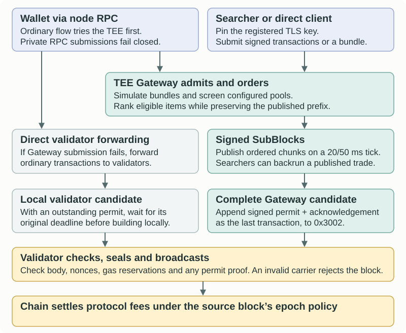

# MEV and the TEE Gateway

New L1 is designed for open, auditable MEV and low-latency trading. Searchers can inspect the ordering rules, observe signed SubBlocks and submit competing arbitrage bundles. Clients that submit directly can authenticate the trusted execution environment (TEE) before disclosing a transaction. Validators verify and seal the complete block, and observers can check its permit and protocol fee distribution on chain.

## Transaction flow and latency

New L1 has no global mempool. Direct routing removes the wait for network-wide transaction propagation from the path to the builder. With a Gateway configured, a node RPC sends ordinary transactions to the TEE first over prewarmed HTTP/2 connections. Bounded batching and separate submission and block-production connections keep a block build from holding up new transactions. The Gateway packs incrementally on a configurable 20 or 50 ms tick and can emit early when enough bytes accumulate. Subscribers can observe the prefix ahead of the target 200 ms block interval. These are packing and block intervals. A user's time to inclusion also depends on network transit, nonce readiness, capacity and the permit deadline.



## Choosing a submission path

| Submission | Who sees the transaction before ordering? | If the Gateway is unavailable |
|---|---|---|
| Ordinary transaction through an RPC node | The RPC operator and the configured next hop | The RPC node can forward ordinary transactions to validators. |
| `newl1_sendPrivateTransaction` through a configured RPC | The RPC operator and the authenticated Gateway | The request fails. Private flow stays out of validator forwarding. |
| Transaction or bundle sent directly to the Gateway | TLS terminates inside the TEE. The client checks the registered TLS key before sending. | The request fails. Direct submission has no fallback. |

There are two fallback decisions. An ordinary RPC submission can go straight to the validator forwarding path if no Gateway is configured or the Gateway request fails. A validator that has already *issued a production permit* must wait for its expiry before building locally. Private transactions and bundles never enter the ordinary forwarding path. An intermediary RPC operator sees the bytes it receives.

The Gateway uses New L1 transaction decoding and lane-aware packing, including eligible native AA batches (`0x76`). One integration exception is native privacy (`0x77`): Gateway admission rejects this type, including inside bundles. Submit V1 batches and V2 EXIT through the standard node RPC's `eth_sendRawTransaction` and ordinary validator path. A private-only Gateway request cannot deliver them.

## What users can audit

| Evidence | What to check |
|---|---|
| Published workload | Gateway operators are expected to publish the core workload source, image reference and integration details. Reviewers can inspect ordering, admission and detection rules, then compare the release's source/build commitment and reference hash with the registered record. Independent reproducible builds and production platform acceptance are separate release milestones. |
| Off-chain attestation | Before registering an instance, the admitted builder admin challenges it with a fresh nonce and verifies platform evidence against the reviewed reference. The evidence binds the instance TLS key and the output signer. Each restart generates new keys and requires review and registration. |
| On-chain identity | GovHub admits builder admins. `TEERegistry` at `0x3001` records eligible builders, releases, and keys by epoch. Verify `getKeyAt(id, epoch)` and pin the registered TLS key when connecting. Chain registration records the admin's admission decision. Hardware evidence is verified off chain. |
| One-slot authority | One validator signs a permit naming one Gateway key, parent, height and expiry. The Gateway accepts one live production permit at a time. Operators configure the endpoint and key locally. The registry imposes no permanent one-to-one validator/Gateway pairing. |
| Published output | Subscribers can verify signed SubBlocks. Anyone with the block body can inspect the permit carrier, signatures and source-epoch fee policy. The proof attests to the Gateway's acknowledgement of the permit. The validator's seal binds the final order. |

For privacy of note ownership after inclusion, see the [shielded pool](privacy.md).

## Bundle admission and ordering

On the Gateway's public WebSocket adapter, a searcher can subscribe to signed SubBlocks with this request:

```json
{"jsonrpc":"2.0","id":1,"method":"newl1_subscribe","params":["subblocks"]}
```

Each `newl1_subscription` notification carries a signed chunk. Searchers can evaluate a backrun against a published trade and submit a bundle for the remaining suffix. The service exposes a stream of published transactions. It does not give searchers a global feed of pending private orders or guarantee an arbitrage window. An optional built-in backrun strategy is a future design.

On a Gateway with the public adapter enabled, submit one object to `newl1_sendBundle`. Replace each placeholder with a signed EIP-2718 transaction in execution order.

```json
{"jsonrpc":"2.0","id":1,"method":"newl1_sendBundle","params":[{"transactions":["0xSIGNED_TX_1","0xSIGNED_TX_2"]}]}
```

The Gateway simulates the bundle on an executed ancestor of the target parent. A revert, failed simulation, timeout, or detected sandwich rejects the bundle. Detection covers swaps from configured V2/V3 pools within that bundle. Cross-bundle activity and unconfigured pools fall outside its coverage. The admission response identifies the simulation ancestor. State can change before the transactions execute.

An admitted bundle competes as one contiguous item. Its score is the sum of each transaction's effective tip times its declared gas limit, divided by total declared gas. Ties use arrival sequence, then hash. The Gateway can append to a streamed prefix. It preserves the bundle's internal order, while each transaction still has its own execution outcome. The request takes only the ordered transactions and accepts no target block. The service accepts up to 32 transactions, 5 million declared gas, and 254 KiB per bundle. Pending bundles expire after 60 seconds or when an executed nonce consumes a constituent transaction.

## Custom ordering for application lanes

A builder already chooses how to interleave eligible transactions from different lanes. Today the Gateway ranks eligible items by effective tip and applies the published bundle rules. An application-specific ordering policy would be a future MEV feature: it could choose which eligible item to append next for a particular lane. Such a policy would need to be part of the auditable Gateway workload and preserve nonce order, every lane’s gas reservation, and any prefix already published. [Lane registration](multi-lane.md#register-and-activate-a-lane) configures routing, capacity and scope.

## Delegated production and fallback

The validator signs a single-slot permit naming the parent, proposer, Gateway key, policy, and deadline. The Gateway acknowledges that permit and returns one complete candidate. Its last transaction carries the signed permit and acknowledgement to the reserved address `0x3002`. The acknowledgement authenticates the permit. The validator's seal and transaction root bind the published body.

The validator checks the candidate, including the permit proof and [whole-block lane reservations](multi-lane.md#guarantees). If an issued permit fails to produce a valid candidate, the validator waits for its original expiry, then builds a complete local block. Local production can select a different body from the streamed prefix. Use the [signed SubBlock stream](#bundle-admission-and-ordering) for early visibility and the canonical block and receipt for settlement.

Packing carries nonce, gas, byte and [lane budgets](multi-lane.md#guarantees) across SubBlocks. The builder reserves room for the proof carrier and a finalization interval for assembling and delivering the candidate. It preserves the validator-supplied system transactions. Importers verify the sealed block against New L1 rules independently of any subscription, including the registered key and source-epoch policy for a claimed proof.

## Fee distribution and unproved blocks

Anyone can reproduce the **protocol fee split** for a source block using its body and the historical rates from `ValidatorSet.mevPolicyAt(epoch)`. With the initial rates, 10,000 units of transaction fees pay 1,000 to burn, 625 to SystemReward and 8,375 to the validator. The validator receives any rounding remainder. The same initial split applies to both production modes.

| Proof in the block | On-chain result |
|---|---|
| Valid permit carrier at the end of the transaction list | Apply the proved-block reward rate. |
| No carrier | The local block is valid under the fallback rate. Governance can increase the fallback share paid to SystemReward, reducing the validator's share. The initial policy imposes no extra financial penalty for missing proof. |
| Present but invalid carrier | Reject the block. It cannot qualify for fallback settlement. |

A searcher's arbitrage profit is separate from these transaction fees. Additional MEV profit attribution, Gateway/validator revenue sharing and claims are roadmap items. The current chain exposes the protocol fee policy and proof evidence. It does not settle a fixed share of off-chain arbitrage profits.
