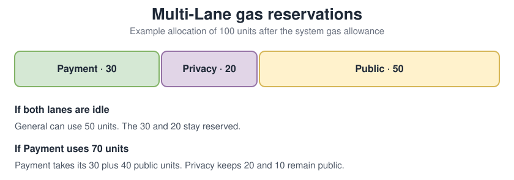
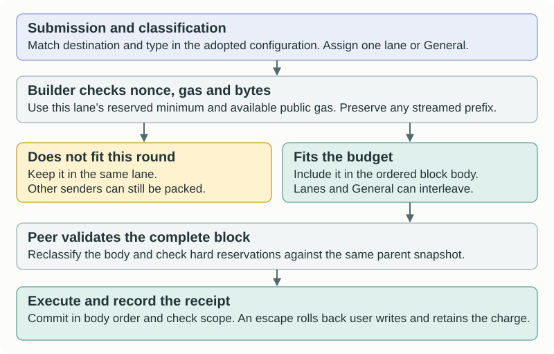
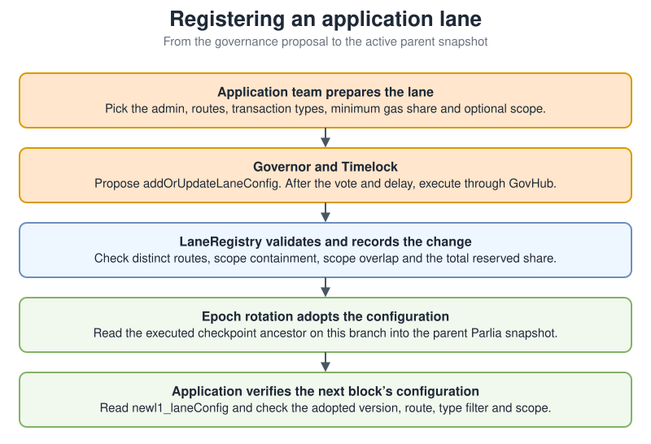

# Multi-Lane

Multi-Lane lets an application request a lane tailored to its traffic. A payments app, for example, can register its token contract, select the transaction types it accepts, reserve a minimum share of block gas, and optionally limit which accounts its transactions may touch. Governance approves the configuration. The app keeps its reservation when unrelated traffic surges and can compete for additional public gas when it is busy.

The longer-term goal is to support many application lanes efficiently as their workloads grow. The current registry supports up to 64 configured lanes. Future parallel execution optimizations could use lane scopes to identify independent work. Custom ordering among eligible transactions belongs to the [MEV builder](mev.md#custom-ordering-for-application-lanes).

## Guarantees

First subtract the system settlement allowance (currently 20 million gas) from the header gas limit, down to a minimum of zero. Each lane reserves its configured share of this **user gas budget**, rounded down. Transactions count at their declared gas limit, including reverts. A proof-funded privacy EXIT counts at its resolved gas quote.

For example, with 100 units of user gas, minima of 30 and 20 leave 50 public units. If both lanes are idle, General can still use only 50. If the first lane uses 70, it takes 40 from the public budget, leaving 10 for General or other lane excess. The second lane keeps its 20 throughout the block.

Builders may interleave lanes in one ordered body. A transaction that cannot fit stays in its lane for a later packing attempt. Other senders can still fit smaller transactions. Importers independently check the whole body's gas budget. A reservation establishes neither a fee tier nor a deadline for any individual transaction.

## A transaction from submission to receipt

The pool classifies a submitted transaction against the adopted configuration. The builder checks the sender's nonce, declared gas and available capacity before packing it. If the transaction cannot fit, it stays in its lane. The next validator can check the complete body from the parent snapshot even if it never saw the builder's SubBlocks. Execution applies the scope at the transaction's position in that body.

## Lane assignment

| Transaction | Classification |
|---|---|
| Ordinary EVM call | Match the top-level destination and the outer transaction type. An empty type filter accepts every supported type. An unmatched call or contract creation goes to General. |
| Native AA batch (`0x76`) | Every call target and any fee token must match the same lane for type `0x76`. A mixed or unmatched batch, creation, or empty batch goes to General. The whole gas limit counts once. |
| Native privacy batch or EXIT (`0x77`) | Always General. An ordinary signed call to PrivacyPool can qualify for a configured lane. |

## Register and activate a lane

1. **Describe the traffic.** Choose an unused lane ID (0–254), a nonzero admin, a minimum in basis points, a name and description. Encode the entry addresses as an ABI `address[]` in `filterParams`. Use `filterTxTypes` to select envelope types and `filterScopes` to declare an optional access boundary. General (255) is implicit.
2. **Propose the configuration.** Through the [governance lifecycle](../governance/overview.md#lifecycle), propose `GovHub.updateParam` targeting `LaneRegistry` at `0x3000`, with key `addOrUpdateLaneConfig` and value `abi.encode(config)`. The registry expects the tuple in the order `(laneId, minGasQuotaBps, filterParams, filterScopes, filterTxTypes, admin, name, description)`.
3. **Vote, queue and execute.** After a successful vote and timelock, GovHub forwards the update. The registry checks route ownership, scope containment and overlap, and the sum of all minima against `reservationLimitBps` (initially 8,000). An invalid update reverts. Governance retains control of quotas, routing, transaction types, admin replacement and removal. The lane admin can change its own name, description and access scope.
4. **Verify activation.** The registry write updates stored configuration. At the delayed epoch rotation, the client reads an executed ancestor of that checkpoint on the same branch and adopts the result in the Parlia snapshot. Read [`newl1_laneConfig`](../developers/json_rpc/newl1-api-list.md#newl1_laneconfig) and check the parent hash, adopted version, route, type filter and scope before submitting traffic that relies on them.

## Scope and cross-lane access

A **route** decides which lane pays for the transaction's gas. A **scope** lists the accounts a transaction routed to that lane may access, including through nested calls. A nonempty scope must include every route of that lane. Two configured scopes cannot claim the same address. An empty scope disables the access guard. General and unscoped transactions can still access a scoped address.

For example, a swap routed through a registered router may touch both a liquidity pool and a token contract. If the router is scoped, include those dependencies in its scope. Adding the token as a scope dependency does not route direct token transfers into the swap lane. The guard also permits authenticated participants such as the sender and fee payer, required AA keychain bookkeeping, read-only precompile access, and limited protocol fee accounting. AA call targets and fee tokens still need to satisfy the lane rules.

A nested access outside that boundary rolls back user writes, retains the declared gas charge and produces a failed execution. The transaction stays in its original lane. Node simulation, including `eth_call` and `eth_estimateGas`, checks the scope for the selected block.

## Parallel execution and future ordering policies

Lane IDs impose no execution order. Two lanes can share a sender, sponsor, or state dependency, even when their configured scopes are disjoint. A [Gateway builder](mev.md#bundle-admission-and-ordering) can interleave eligible traffic while respecting nonce dependencies, hard reservations and its published prefix.

Optimistic parallel execution (OPE) is opt-in (`--execution.ope true`). The engine can run eligible transactions from different lanes on workers against the same parent state. The committer visits them in block order, checks speculative reads against the preceding transactions' writes, and re-executes when a result is stale. It applies the lane guard to the result it commits. Receipts, gas, logs and state must match sequential execution. Native privacy transactions (`0x77`) use ordered execution. For example, two transfers that update different token contracts can be speculated at the same time. If both transactions also debit the same sponsor, the later result can require re-execution. The speedup depends on actual reads and writes.

A future parallel EVM (PEVM) scheduler could use scopes to run more independent application workloads concurrently as additional lanes come online. It would still need to account for shared sponsors and other dependencies, and produce the same receipts and state as the sealed transaction order. The current OPE scheduler discovers conflicts from actual transaction accesses.

## Devnet example

Devnets generated with the lane preset install Payment and Privacy with 2,000 bps each, empty access scopes, and legacy/EIP-1559 filters. Payment routes to the seeded token and Privacy to the pool. Other deployments can adopt different configurations.
