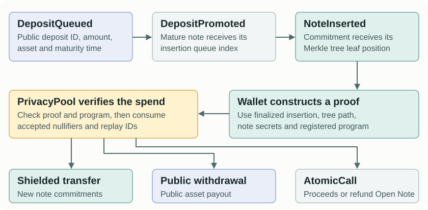
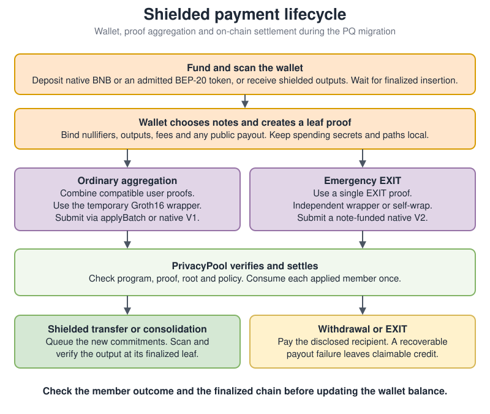

# Shielded Pool

The shielded pool already supports **native BNB and admitted BEP-20 tokens**. A shielded payment hides the sender’s and recipient’s note ownership, the asset, and the amount transferred. A wallet encrypts the recipient’s note and proves in zero knowledge that it can spend its inputs. `PrivacyPool` at `0x5000` verifies the proof and settles the payment. [AtomicCall](#accessing-evm-contracts-with-atomiccall) extends this model to approved public EVM contracts, including swaps.

Protecting note contents against future quantum decryption is a design priority. Note delivery combines ML-KEM-768 with X25519. Wallets prove spends with zk-STARKs. During the chain’s post-quantum (PQ) migration, an aggregator wraps the aggregated STARK proof in Groth16 for the current on-chain verifier. After the migration, the plan is to submit and verify zk-STARK proofs directly on chain. See [security assumptions](#security-assumptions).

!!! note "Development status"
    The default genesis requires pool initialization through GovHub. A preinitialized development package installs a registered program and verifier. Real-proof spending of freshly deposited notes, wallet recovery acceptance, and final EXIT gas calibration remain open. Use development assets only.

## What a shielded payment reveals

Inside the pool, value belongs to **notes**. A standard note commits to its pool, version, owner commitment, asset, value and fresh randomness. The pool records a hash in a Merkle tree. A wallet proves in zero knowledge that it controls notes under an accepted root and that inputs cover the authorized outputs, fees and public withdrawals. The proof reveals a **nullifier** for each real input, derived from a secret key, the commitment and its leaf position. The pool can reject a second spend without revealing which leaf was spent.

| Operation | Hidden by the shielded model | Visible on chain |
|---|---|---|
| Shielded-to-shielded payment | Input leaves, shielded owners, transferred asset and amount | Operation shape, nullifiers, output commitments, ciphertexts, service fee and any public gas payer |
| Deposit | The link to a later shielded spend | Depositing account, asset, amount, owner commitment, randomness and insertion history |
| Withdrawal or EXIT | Which tree leaves funded the payout | Public recipient, asset, amount and fee information |
| AtomicCall | The link to the input notes | Target, public asset movements, and the resulting Open Note's public asset and amount |

Pool size and timing also affect privacy. A payment between two shielded owners offers little practical ambiguity if only one observable deposit could plausibly fund it. Transaction submission can expose network metadata independently of what the proof hides.

## From deposit to spendable note

1. Submit an ordinary `deposit` call to the initialized pool. For a token, provide allowance or a supported EIP-2612 permit. A token deposit can also fund a separate BNB reserve note. The depositor, asset, amount, owner commitment, and note randomness are visible even when optional deposit ciphertext is supplied.
2. Read `DepositQueued` for the deposit ID and its fixed maturity time. The default delay is one day. At maturity the protocol can promote the note into the insertion queue. Even a zero-delay devnet must wait for insertion.
3. Match `DepositPromoted` to its queue index, then `NoteInserted` to its actual leaf position. A wallet needs the tree path, spending keys, and finalized insertion before treating the note as spendable.

**Launch accumulation and deposit delay are independent.** After pool initialization, governance can admit deposits while keeping transfer, withdrawal and call switches closed. This lets eligible notes accumulate before opening spending. The contract does not automatically open spending at a given deposit count or guarantee an anonymity-set size. Each deposit keeps the maturity deadline assigned at acceptance, even if governance changes the delay later. A preinitialized devnet can use different switches and a zero delay.

## Wallet, prover and aggregator flow

1. **Scan and select.** The wallet scans finalized pool history, verifies owned deposits or decrypts incoming shielded outputs, reconstructs their Merkle paths and checks spent nullifiers. It chooses inserted, unspent notes for the asset and any required BNB fee reserve.
2. **Authorize and prove locally.** For a transfer, the wallet creates a recipient note and any change, encrypts the outgoing note data, and binds the outputs and fee to the intent. For a withdrawal it binds the public recipient, asset and amount. The user's leaf STARK proves ownership, membership and value conservation. The aggregator receives that proof, its public intent and delivery data. The keys, plaintext input notes and Merkle paths stay with the prover.
3. **Aggregate and submit.** The off-chain aggregator combines compatible leaf proofs recursively and wraps the aggregate in a 384-byte Groth16 proof. A public payer submits the batch through ordinary `applyBatch(bytes)` or signed native V1. Admission by a service is an acknowledgement. The chain verifies the proof and applies each eligible member against current state. The wallet must check its own member outcome, since a member can be skipped even if another member settles.
4. **Receive or withdraw.** For a private payment the recipient scans and decrypts the output, verifies the commitment, and waits for finalized insertion before spending it. For a withdrawal the pool attempts the public payout during settlement. If delivery fails recoverably, the public recipient has an on-chain credit to collect with `claim(asset, to)`. A withdrawal has no additional maturity timer.

**Consolidating small notes.** The standard transfer shape has two asset-input slots and a BNB reserve slot. A wallet holding many small notes can first use the consolidation shape: up to four asset inputs plus a BNB reserve input become a consolidated note and BNB change. For fragmented BNB, the wallet can consolidate BNB itself and pay the service fee from those inputs. The consolidation shape is public. The wallet waits for the new note's finalized insertion before using it in a payment.

The wallet, proving and aggregation steps describe the integration expected by the chain. The current development verifier accepts matching proof samples. A matching wallet/prover release and fresh-note end-to-end acceptance are still required.

## Spending paths

| Entry | Network fee and identity | Typical use |
|---|---|---|
| Ordinary signed call to `applyBatch(bytes)` | A public sending account pays gas | Submit a proof-verified service batch through the EVM ABI. |
| Native `0x77` V1 | A public payer signs with an account nonce and declares gas and fee caps | Submit a batch using the native envelope. The proof authorizes the spends. |
| Native `0x77` V2 EXIT | The notes fund the quoted fee. No outer payer signature or account nonce is required. | Exit using the immutable EXIT profile registered for the program. |

For V1, pass the unsigned `privacyBatch` declaration to `newl1_estimateGas` before signing. For V2, read the registered fee with `quoteExit(bytes)` on the pool. Submit canonical V1 or V2 bytes to a node RPC with `eth_sendRawTransaction`. The TEE Gateway rejects native privacy envelopes, including bundle members. An encrypted note and a private route to a block builder protect different information.

## Accessing EVM contracts with AtomicCall

A wallet can authorize a public EVM operation from a shielded spend. For example, a user can spend a note to swap tokens through an allowlisted DEX router. The proof binds the call context. The pool checks the target policy, funds a one-use forwarder, and measures the assets returned by the router. Success produces an Open Note for those proceeds. The public can see the target, the asset movements and the Open Note’s amount. Observers see the spend nullifiers while the proof hides which leaves the user consumed. A recoverable target failure rolls back the call's effects and refunds the input principal as an Open Note. The accepted spend and its fee remain consumed. Invalid proofs are rejected before spending.

## Emergency exit when the ordinary service is unavailable

A wallet with finalized spendable notes and enough shielded BNB for the fee can prepare a single EXIT intent for a fixed public recipient. The integration design lets the user hand the same leaf proof to an independent wrapper or wrap it locally. The wrapper produces the registered one-member proof and submits native V2. The proof binds the recipient, spending authority and fee limits. Nullifier and replay checks allow the first successful submission to consume the notes once.

On chain, `quoteExit(bytes)` resolves the registered program's fixed fee. The pool pays the chain fee, credits wrapper compensation and sends the remaining principal and any BNB residue to the designated recipient. EXIT creates no new note and can operate with a full tree. It still requires a valid program and proof, the withdrawal switch, and a permitted public recipient. It provides a path around an unavailable aggregator. It cannot override governance or recover an invalid proof. Self-wrapping tools and independent service availability remain release dependencies.

## Discovery and recovery

Read `newl1_getPrivacyChainConfig("finalized")` to identify the pool, chain, and executed snapshot. For a public deposit, match the published owner commitment locally and verify the note commitment. For encrypted outputs, replay receiving-key registration, rotation, and retirement events from the pool and use the matching private viewing material. `register`, `rotateMlkem`, and `retireMlkem` manage receiving-key versions.

Wallets should reconcile live log notifications against complete finalized ranges, including insertion and spending history. A missing range leaves the recovered balance unknown. Full historical pool logs may require an archive provider.

## Security assumptions

### Post-quantum design and its limits

The note-delivery format is designed to protect recorded ciphertext against future quantum decryption. HNC-1 combines X25519 and ML-KEM-768, derives a key with HKDF-SHA256, and uses AES-256-GCM for authenticated encryption. The wallet keeps viewing and spending secrets separate. The pool uses KoalaBear-based hashes for note and tree commitments. These mechanisms have different jobs: encryption delivers the note, the zero-knowledge proof authorizes spending, and the nullifier prevents reuse.

The temporary BN254 Groth16 wrapper introduces a trusted-setup assumption during the migration. Native V1 also uses a classical public-payer signature. Direct on-chain STARK verification is the migration target; the current devnet accepts the wrapped proof. Production readiness requires reviewed circuits and setup, matched verifier and prover artifacts, and demonstrated recovery and EXIT using real deposited notes.

### Policy at the public boundaries

| Policy | Enforcement point |
|---|---|
| Deposit | The pool checks the immediate caller against the on-chain blacklist. Governance can pause deposits and restrict admitted token contracts. |
| Withdrawal and EXIT | The pool screens the disclosed payout recipient against the blacklist. A later claim of payout credit also checks its destination. Hidden note owners are outside these address checks. |
| AtomicCall | The call switch must be enabled, the entry-point address allowlisted, and the proof-bound policy ID registered for that target. The check applies to the entry address, including a proxy. It does not pin individual function selectors or the implementation behind a proxy. |

For confidentiality *before ordering* through a TEE, see [MEV and the TEE Gateway](mev.md).
