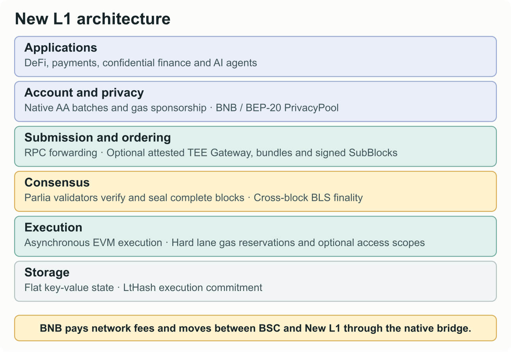

# New L1 - High-Performance EVM L1

New L1 is an EVM-compatible Layer 1 and the next generation chain in the BNB Chain family. It targets workloads that need sub-second finality and predictable inclusion, including high-frequency trading, real-time payments, confidential finance, and agent-driven activity. Under the proposed Parlia design, cross-block BLS votes target transaction-order finality in under one second at the 200 ms block interval. During delegated production the Gateway can stream signed SubBlocks on a 20 or 50 ms tick. Execution finality occurs only after a subsequent block records the `ExecutionCommitment` and that block itself finalizes.

## Key Features and Advantages

Execution runs off the consensus critical path, so ordering never waits on it. State lives in a flat key-value store under a cumulative lattice-hash commitment, with no Merkle-Patricia trie underneath.

- **Customize block space.** An application can request its own routes, minimum gas share and access scope. Scope-aware parallel execution is a future direction for scaling across many application lanes. [Multi-Lane](./core-concepts/multi-lane.md)
- **Trade under auditable ordering rules.** Direct submission to an authenticated TEE avoids global mempool propagation. Searchers see signed SubBlocks and can submit bundles while the block is being built. Future lane-specific ordering policies belong at this builder layer. [MEV and the TEE Gateway](./core-concepts/mev.md)
- **Pay privately and call public contracts.** Shielded notes hide ownership, asset and amount in private transfers. Hybrid post-quantum encryption protects note delivery, zero-knowledge proofs authorize spending, and AtomicCall lets a user access an approved EVM contract from the pool. [Privacy](./core-concepts/privacy.md)

## Where New L1 Fits

| | | |
|---|---|---|
| 2017 | ERC-20 BNB | utility token on Ethereum |
| 2019 | Beacon Chain | governance and staking |
| 2020 | BSC | general-purpose EVM L1 |
| 2023 | opBNB + Greenfield | scaling and decentralized storage |
| Next | New L1 | latency-first EVM L1, optimized end to end |

BSC remains the broad-base chain for the existing ecosystem. New L1 is a clean-slate design for the workloads that outgrow it. It stays fully EVM-compatible and keeps BNB at the economic center, on the same tooling as BSC, opBNB, and Greenfield.

## Architecture

| Layer | What's in it | Read more |
|---|---|---|
| Application | DeFi, payments, confidential finance, and AI agents. PrivacyPool supports BNB and admitted BEP-20 deposits, proof-verified spends, withdrawals, and calls | [Privacy](./core-concepts/privacy.md) |
| Account & UX | Gas sponsorship, passkey (WebAuthn/P256) signing, batched calls, and scoped access keys, all as a native transaction type (`0x76`). No bundler, no entry-point contract, and the sender need not hold BNB | [Account Abstraction](./core-concepts/account-abstraction.md) |
| Execution | Parallel EVM, with ordering decoupled from execution: consensus liveness does not depend on execution throughput. Multi-Lane reserves gas capacity per transaction class, so latency-sensitive traffic can't be crowded out | [Async Execution](./core-concepts/async-execution.md) · [Multi-Lane](./core-concepts/multi-lane.md) |
| Consensus | Enhanced Parlia uses cross-block BLS votes to target transaction-order finality in under one second, at the target 200 ms block interval. Execution finality follows only after a later block records the result and itself finalizes. | [Consensus](./core-concepts/consensus.md) · [Pre-confirmation](./core-concepts/tx-preconfirmation.md) |
| Network | RPC nodes forward ordinary traffic to a configured Gateway or validators. Private submissions and bundles require a Gateway. Validators gossip complete sealed blocks | [MEV and the TEE Gateway](./core-concepts/mev.md) |
| Storage | Flat key-value store under a cumulative lattice-hash (LtHash) commitment instead of a Merkle-Patricia trie | [State DB](./core-concepts/state-db.md) |
| Governance | Token-weighted (govBNB) proposal / vote / timelock control over protocol parameters, including the Multi-Lane quotas | [Governance](./governance/overview.md) |

## Role of BNB

BNB is the native asset of New L1, and no new token is issued. It pays for gas and moves between BSC and New L1 through the native [Cross-Chain Bridge](./core-concepts/cross-chain-bridge.md). Staking it with `StakeHub` mints govBNB 1:1, a non-transferable voting ledger that carries governance weight once it is delegated.

## What This Means for Developers

Existing Solidity contracts and standard wallet flows run unchanged. Contracts, opcodes, and EVM behave exactly as on any other EVM chain, since execution builds on [reth](https://github.com/paradigmxyz/reth) and [revm](https://github.com/bluealloy/revm). Four things around it changed:

- **You pay for your declared gas limit, not gas used.** Block space is sold by declared gas before execution runs ([details](./get-started/migrate-from-bsc.md#you-pay-for-your-declared-gas-limit)).
- **There is no global mempool.** The submission path determines who sees a pending transaction and whether validator fallback is available. See [MEV and the TEE Gateway](./core-concepts/mev.md).
- **`eth_getProof` is unsupported, and so are EIP-4844 and EIP-7702 transactions.** [JSON-RPC Endpoint](./developers/json_rpc/json-rpc-endpoint.md) lists every difference in the RPC surface.
- **New features are additive.** Account abstraction, pre-confirmation, Multi-Lane, and the shielded pool run alongside standard transactions, and none of them change how an existing contract behaves.

Start with [Migrating from BSC](./get-started/migrate-from-bsc.md) if you already ship on BSC, or the [Quick Guide](./developers/quick-guide.md) if you don't.

## Network Parameters

| Parameter | Value |
|---|---|
| Block interval | 200 ms |
| Finality | sub-second (BLS fast finality) |
| Pre-confirmation | Optional Gateway SubBlock stream, 20 or 50 ms packing tick |
| Turn length (blocks per validator, per rotation) | 16 |
| Consensus | enhanced-Parlia |
| Gas asset | BNB (bridged from BSC) |

## Current Status

New L1 runs today as a multi-validator devnet with real block production and end-to-end finality. Public testnet and mainnet are still ahead, and each feature page calls out what's shipped versus still in progress.

The [RPC reference](./developers/json_rpc/newl1-api-list.md) describes client behavior. The deployed endpoint may run a different release. The [privacy page](./core-concepts/privacy.md) describes which end-to-end flows still require acceptance.
